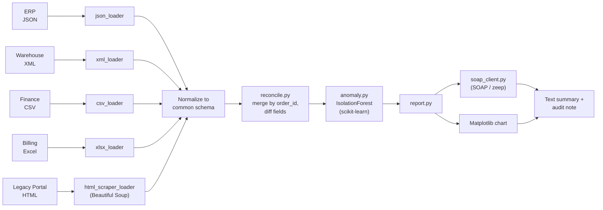
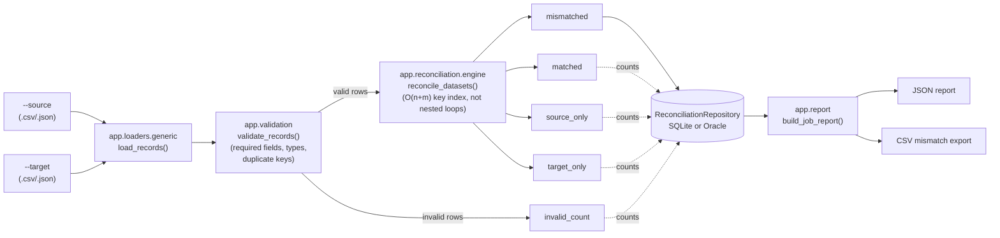

# recon-toolkit

A configurable data reconciliation and validation platform: compare two
datasets (CSV/JSON) on a configurable business key and per-field rules,
persist job metadata and results to a relational database (SQLite for
local dev, Oracle Database + PL/SQL for production-style deployments), and
emit JSON/CSV reports. Also ships the original 5-source order
reconciliation demo it grew out of.

## Two ways to use it

| | `main.py demo` | `main.py run` |
|---|---|---|
| Datasets | Fixed: 5 hardcoded sample sources (JSON/XML/CSV/XLSX/HTML) | Any two: `--source`/`--target`, CSV or JSON |
| Business key | Fixed: `order_id` | Configurable: `--key` (repeatable, composite keys supported) |
| Field rules | Fixed: exact match + amount tolerance | Configurable: `--compare field:rule` (exact / numeric tolerance / date / case-insensitive) |
| Persistence | None (demo is intentionally file-in/file-out) | Job metadata + summary + mismatches in SQLite or Oracle |
| Output | PNG chart + text summary + ML-prioritized triage | JSON + CSV reports |
| Why it exists | Shows the "no two systems agree on format" shape of real reconciliation work, plus a light ML triage layer | Shows SQL/PL-SQL, validation, and a reusable reconciliation engine |

## What `demo` does

Reconciles order records across five independent systems that each export
their own copy of the same underlying data in a different format — JSON
(ERP), XML (warehouse), CSV (finance), Excel (billing), and a legacy HTML
report with no export of its own — and surfaces where they disagree.

1. **Load** — one loader per source format (`app/loaders/`), each normalizing
   into a common schema. The legacy HTML report is scraped with
   **Beautiful Soup**, since it has no API or structured export at all.
2. **Reconcile** — `app/reconcile.py` merges all sources by `order_id` and
   flags records that are missing from a source entirely, or whose
   `amount`/`status`/`customer`/`date` disagree across sources (with a small
   tolerance for float rounding noise on `amount`, and first-record-wins
   handling for a duplicate `order_id` within one source — see
   `docs/root-cause-analysis.md` scenario 1).
3. **Triage with ML** — `app/anomaly.py` fits a **scikit-learn**
   `IsolationForest` over a few numeric features (missing-source count,
   mismatched-field count, amount spread) to rank discrepancies by how
   anomalous they are, so review starts with the highest-signal cases.
4. **Report** — `app/report.py` renders a **Matplotlib** bar chart of
   discrepancy types and a text summary. The summary's total-mismatch figure
   is rendered to words via a **SOAP** client (`app/soap_client.py`, using
   `zeep`) as a human-readable audit note — with a graceful fallback if the
   SOAP endpoint is unreachable.



## What `run` does

A generic, configurable reconciliation engine for an arbitrary source and
target dataset, with a real relational persistence layer behind it.



Validation and reconciliation are independent of the database: `run`
without any Oracle/SQLite instance reachable simply fails at the
`repo.initialize_schema()` step with a typed `DatabaseConnectionError` —
nothing upstream of persistence depends on the backend being up.

## Architecture

```
main.py                    CLI entry point (demo + run subcommands)
app/
  errors.py                 Exception hierarchy (Validation/Database/Transaction/...)
  logging_config.py          Structured logging + redaction helper
  validation.py              Generic schema validation for the `run` path
  reconcile.py                5-source demo engine (order_id, fixed fields)
  anomaly.py                  IsolationForest triage for the demo
  report.py                   Chart/text (demo) + JSON/CSV (generic) reports
  soap_client.py               SOAP "amount to words" audit note
  loaders/
    csv_loader.py, json_loader.py, xlsx_loader.py,     # demo loaders:
    xml_loader.py, html_scraper_loader.py, schema.py   # fixed schema, eager validation
    generic.py                                          # run loaders: raw records, format-only
  reconciliation/
    engine.py                 Generic two-dataset engine (configurable key + rules)
    rules.py                   Field comparators: exact, numeric_tolerance, date_equal, case_insensitive
  db/
    base.py                    ReconciliationRepository interface + dataclasses
    sqlite_repo.py              SQLite implementation (stdlib sqlite3)
    oracle_repo.py              Oracle implementation (python-oracledb)
db/
  sqlite/schema.sql            SQLite DDL
  oracle/schema.sql            Oracle DDL
  oracle/plsql/reconciliation_pkg.sql   PL/SQL package (summary, data-quality, purge)
docs/
  database-schema.md, oracle-setup.md, root-cause-analysis.md, troubleshooting.md
tests/
  ... (local, no external dependencies)
  oracle/                     Requires a live Oracle instance; excluded by default
```

## Installation

```bash
python -m venv .venv && source .venv/bin/activate
pip install -r requirements.txt
```

Optional extras:

```bash
pip install -r requirements-dev.txt      # ruff, mypy, pandas-stubs
pip install -r requirements-oracle.txt   # python-oracledb, only for --db-backend oracle
```

## Environment variables

Only used by `main.py run --db-backend oracle`. Not read for SQLite (which
takes its path from `--sqlite-path`) or for `main.py demo`.

| Variable | Required for | Example |
|---|---|---|
| `ORACLE_DSN` | Oracle backend | `localhost:1521/XEPDB1` |
| `ORACLE_USER` | Oracle backend | `recon_app` |
| `ORACLE_PASSWORD` | Oracle backend | (never commit a real value) |

Copy `.env.example` to `.env` for local reference; `main.py` does not
auto-load `.env` files, so `export` these yourself or use your shell/CI
secret manager. **Never commit credentials, API keys, or a real `.env`.**

## Running it

### Demo

```bash
python scripts/generate_sample_data.py   # synthetic data with injected discrepancies
python main.py demo
# or just: python main.py   (defaults to demo)
```

Outputs `output/reconciliation_report.png` and `output/reconciliation_summary.txt`.

### Generic reconciliation (SQLite backend, no setup required)

```bash
python main.py run \
  --source data/sample/erp_orders.json \
  --target data/sample/finance_orders.csv \
  --source-name erp --target-name finance \
  --key order_id \
  --compare amount:numeric:0.01 --compare status --compare date:date \
  --db-backend sqlite --sqlite-path recon.db \
  --out-dir output
```

`--compare` rules: `field` (exact match, default), `field:numeric:<tolerance>`,
`field:date` (tolerates `YYYY-MM-DD`, `MM/DD/YYYY`, etc.), `field:ci`
(case-insensitive string). `--key` may be repeated for a composite business
key, e.g. `--key region --key order_id`.

Prints a one-line summary, writes `<job_id>_report.json` and
`<job_id>_mismatches.csv` to `--out-dir`, and persists job metadata,
summary counts, and field-level mismatches to the SQLite database at
`--sqlite-path` (see `docs/database-schema.md`).

### Generic reconciliation (Oracle backend)

See `docs/oracle-setup.md` for provisioning an instance; then:

```bash
export ORACLE_DSN=localhost:1521/XEPDB1 ORACLE_USER=recon_app ORACLE_PASSWORD=...
python main.py run --source ... --target ... --key order_id --db-backend oracle
```

### Sample report

```json
{
  "job_id": "eca9fb23-1b67-40ce-9a0c-cc44362b594e",
  "status": "completed",
  "source_name": "erp",
  "target_name": "finance",
  "source_count": 3,
  "target_count": 3,
  "matched_count": 1,
  "mismatched_count": 1,
  "source_only_count": 1,
  "target_only_count": 1,
  "invalid_count": 0,
  "duration_seconds": 0.0149,
  "field_mismatches": [
    {"business_key": "2", "field": "amount", "source_value": 250.0, "target_value": 275.0}
  ],
  "error_summary": null
}
```

## Database schema

See `docs/database-schema.md` for the full data dictionary, and
`db/sqlite/schema.sql` / `db/oracle/schema.sql` for the DDL itself.

## Oracle Database and PL/SQL

Genuine Oracle integration behind `app/db/oracle_repo.py`
(`python-oracledb`), with `db/oracle/plsql/reconciliation_pkg.sql`
providing server-side summary and data-quality procedures (ref cursors,
named exceptions via `RAISE_APPLICATION_ERROR`, explicit `COMMIT`/`ROLLBACK`
in `purge_old_jobs`). **This has not been executed against a live Oracle
instance in this development environment** — see `docs/oracle-setup.md`
for how to provision one and run `tests/oracle/` against it.

## Testing

```bash
pip install -r requirements.txt -r requirements-dev.txt
python scripts/generate_sample_data.py
python -m pytest -q                 # local tests only; Oracle tests auto-skip without credentials
ruff check .
mypy app main.py
```

To run the Oracle-only suite against a real instance:

```bash
export ORACLE_DSN=... ORACLE_USER=... ORACLE_PASSWORD=...
pytest -m oracle -v
```

Covers: all five demo loaders, the demo reconciliation diff (including the
duplicate-key and missing-entire-source edge cases), anomaly ranking, the
SOAP client, generic-engine matching/mismatches/NULL-handling/date-and-numeric
rules/composite keys/determinism, input validation (missing fields, bad
types, duplicates, empty input, malformed JSON), SQLite persistence
(including transaction rollback on constraint violations), JSON/CSV report
accuracy, and a large-dataset (20,000-record) reconciliation to guard
against an accidental regression to nested-loop (O(n·m)) comparison.

## Troubleshooting

See `docs/troubleshooting.md`, and `docs/oracle-setup.md`'s troubleshooting
table for Oracle-specific issues.

## Root cause analysis

See `docs/root-cause-analysis.md` for four reproducible failure scenarios
(two real defects found and fixed during this upgrade, two simulated
infrastructure failures), each with symptoms, repro steps, root cause,
fix, and regression test.

## Stack

Python, pandas, NumPy, openpyxl, Beautiful Soup, scikit-learn, Matplotlib,
zeep (SOAP), stdlib `sqlite3`, `python-oracledb` (optional), pytest, ruff,
mypy, GitHub Actions.
