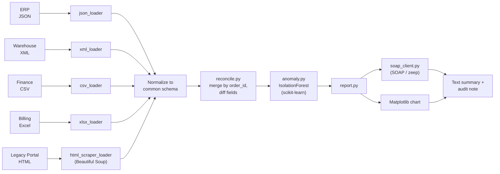
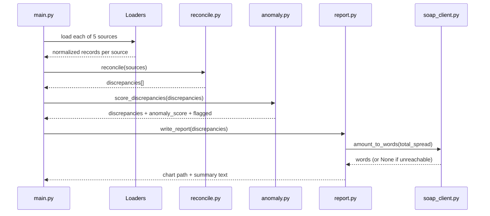

# recon-toolkit

Reconciles order records across five independent systems that each export
their own copy of the same underlying data in a different format — JSON
(ERP), XML (warehouse), CSV (finance), Excel (billing), and a legacy HTML
report with no export of its own — and surfaces where they disagree.

This is the shape most "data reconciliation and file comparison across
systems" work actually takes: no two systems agree on schema or format, at
least one only exists as an HTML table, and most disagreements are noise
(rounding, timing) rather than real errors — which is why a lightweight ML
pass sits on top of the rule-based diff to prioritize triage instead of
dumping every mismatch on a human equally.

## What it does

1. **Load** — one loader per source format (`app/loaders/`), each normalizing
   into a common schema. The legacy HTML report is scraped with
   **Beautiful Soup**, since it has no API or structured export at all.
2. **Reconcile** — `app/reconcile.py` merges all sources by `order_id` and
   flags records that are missing from a source entirely, or whose
   `amount`/`status`/`customer`/`date` disagree across sources (with a small
   tolerance for float rounding noise on `amount`).
3. **Triage with ML** — `app/anomaly.py` fits a **scikit-learn**
   `IsolationForest` over a few numeric features (missing-source count,
   mismatched-field count, amount spread) to rank discrepancies by how
   anomalous they are, so review starts with the highest-signal cases.
4. **Report** — `app/report.py` renders a **Matplotlib** bar chart of
   discrepancy types and a text summary. The summary's total-mismatch figure
   is rendered to words via a **SOAP** client (`app/soap_client.py`, using
   `zeep`) as a human-readable audit note — with a graceful fallback if the
   SOAP endpoint is unreachable, the same degrade-safely pattern used
   elsewhere for third-party dependencies.

## Data flow



## Sequence: one reconciliation run



## Running it

```bash
python -m venv .venv && source .venv/bin/activate
pip install -r requirements.txt
python scripts/generate_sample_data.py   # synthetic data with injected discrepancies
python main.py
```

Outputs `output/reconciliation_report.png` and `output/reconciliation_summary.txt`.

## Testing

```bash
python -m pytest -q
```

Covers all five loaders, the reconciliation diff logic (including the
missing-entire-source edge case), the anomaly ranking, and the SOAP client
(mocked for the failure path, live for the happy path — skipped rather than
failed if the public demo endpoint is unreachable).

## Stack

Python, pandas, NumPy, openpyxl, Beautiful Soup, scikit-learn, Matplotlib,
zeep (SOAP), pytest, GitHub Actions.
